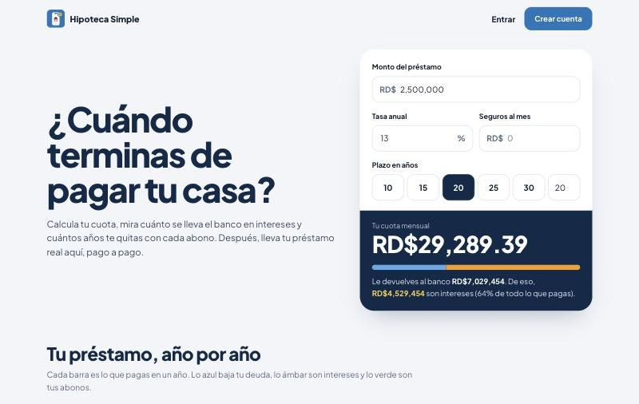
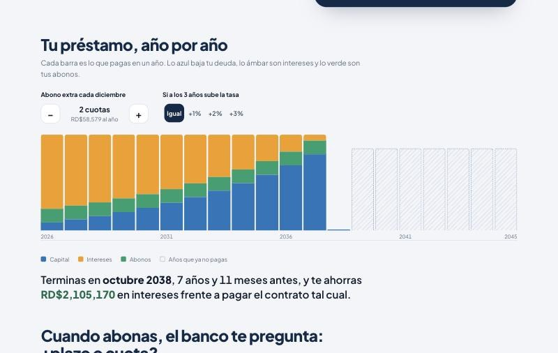
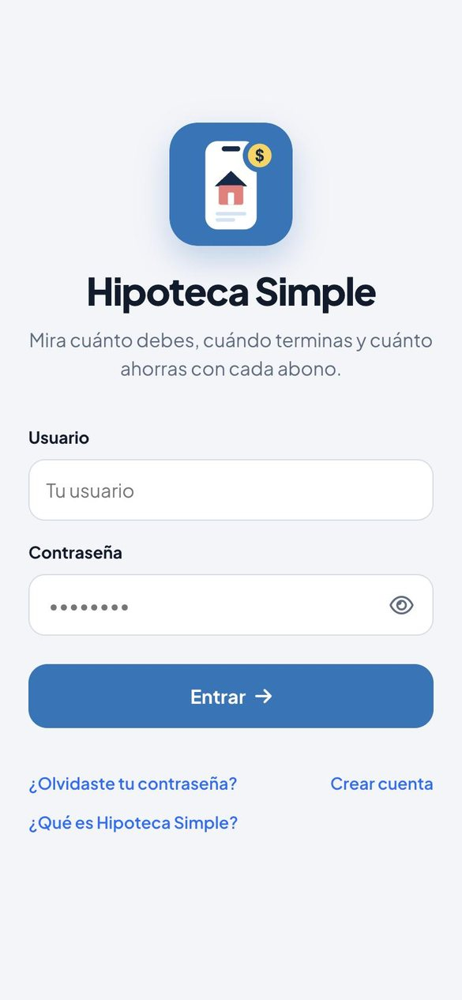
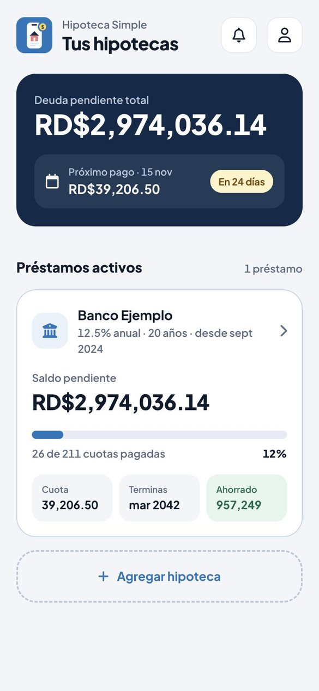
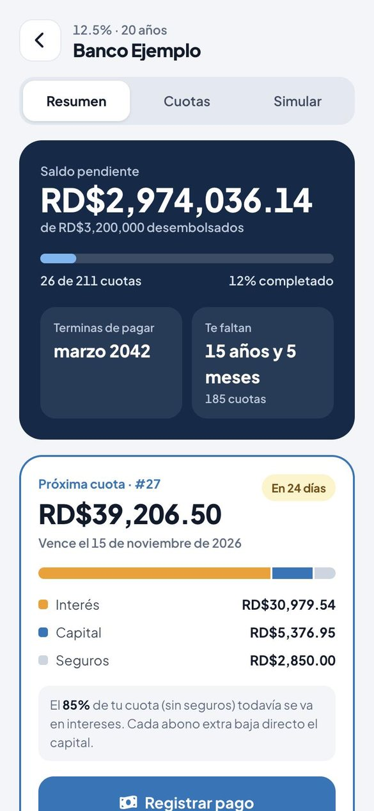
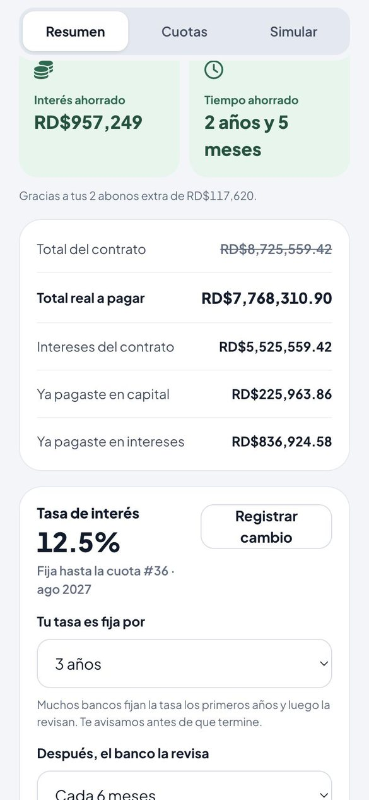
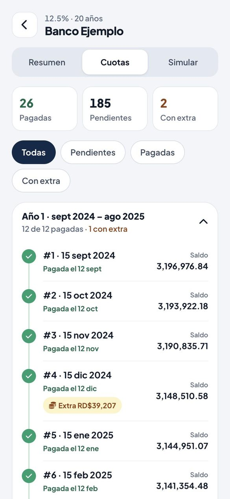
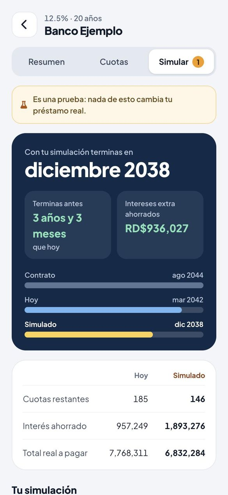
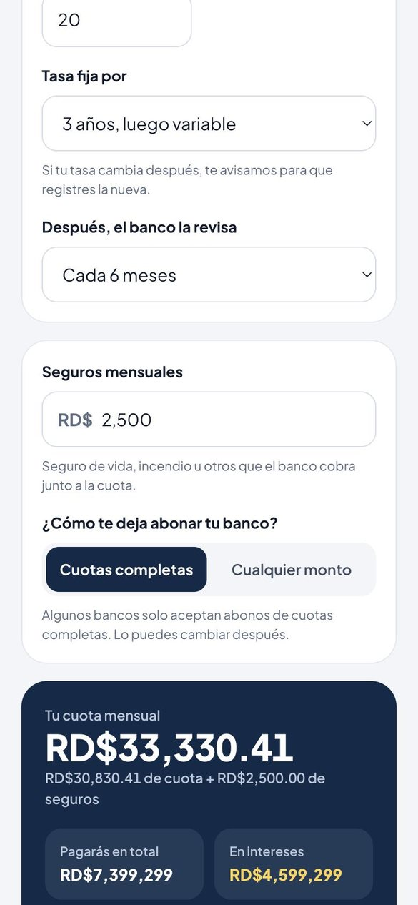

<div align="center">

# 🏠 Hipoteca Simple

**Gestiona tus hipotecas y visualiza tu tabla de amortización — con simulación de pagos extra para saber cuánto tiempo e intereses ahorras.**


</div>

---

## 📸 Capturas

> Datos de una cuenta de demostración (préstamo inventado).

<p align="center">
  
</p>
<p align="center"><em>Página de presentación: calcula tu cuota sin crear cuenta.</em></p>

<p align="center">
  
</p>
<p align="center"><em>Tu préstamo año por año: con cada abono desaparecen los últimos años.</em></p>

<table>
  <tr>
    <td align="center"><br><sub>Inicio de sesión</sub></td>
    <td align="center"><br><sub>Tus hipotecas</sub></td>
    <td align="center"><br><sub>Resumen y próxima cuota</sub></td>
    <td align="center"><br><sub>Lo ahorrado y la tasa</sub></td>
  </tr>
  <tr>
    <td align="center"><br><sub>Cuotas por año</sub></td>
    <td align="center"><br><sub>Simulador de abonos</sub></td>
    <td align="center"><br><sub>Nueva hipoteca</sub></td>
    <td></td>
  </tr>
</table>

---

## ✨ Características

- 🔐 **Login** con autenticación por token (Bearer).
- 📋 **Listado de hipotecas** con alta y baja.
- ➕ **Crear hipoteca**: monto, interés, plazo, seguros, banco y día de pago; cálculo de cuota en vivo.
- 📊 **Tabla de amortización** completa (cuota, interés, capital, saldo pendiente).
- 💸 **Pagos extra / anticipados** con dos estrategias:
  - **Reducir tiempo** → terminas antes de plazo.
  - **Reducir cuota** → pagas menos cada mes.
- 📈 **Resumen inteligente**: total a pagar, intereses, **interés ahorrado** y **tiempo ahorrado**.
- 📅 **Fecha de vencimiento** de cada cuota (a partir de la creación y el día de pago).
- 📱 **100% responsive / app-like en móvil**:
  - La tabla de amortización se convierte en **tarjetas** apiladas.
  - Cuotas pagadas **minimizadas** (tap para expandir), con distintivo de **pago extra**.
  - **Cuota actual** resaltada con salto automático y botón de pago directo.

---

## 🧱 Estructura del proyecto

```
HipotecaSimple/
├── Api/                      → Backend (ASP.NET Core Web API + EF Core)
│   └── HipotecaSimple/
│       ├── Controllers/      → Usuarios, Hipoteca
│       ├── Data/             → DbContext y entidades
│       ├── Program.cs
│       └── appsettings.example.json
└── Web/                      → Frontend (Angular 16 + Bootstrap 5)
    └── src/
        ├── app/components/   → pantallas (bienvenida, login, inicio, hipoteca-crear, hipoteca-detalle…)
        ├── app/services/     → data.service, guard de sesión, config (lee config.json)
        └── config.example.json → plantilla de la dirección del API
```

---

## 🛠️ Stack tecnológico

| Capa | Tecnologías |
|------|-------------|
| **Frontend** | Angular 16 · Bootstrap 5.3 · ngx-mask · SweetAlert2 · Font Awesome |
| **Backend**  | ASP.NET Core (.NET 7) · Entity Framework Core · JWT Bearer · Swagger |
| **Base de datos** | SQL Server |

---

## 🚀 Puesta en marcha

### Requisitos
- [Node.js](https://nodejs.org/) 18+ y npm
- [.NET SDK 7.0](https://dotnet.microsoft.com/download)
- SQL Server (local o remoto)

### 1) Clonar
```bash
git clone https://github.com/ericgutierre01/HipotecaSimpleWeb.git
cd HipotecaSimpleWeb
```

### 2) Configurar los secretos (obligatorio)
Por seguridad, la URL del servidor y la cadena de conexión **no** están en el repo. Copia las plantillas y complétalas con tus valores:

```bash
# Backend: cadena de conexión a tu SQL Server
cp "Api/HipotecaSimple/appsettings.example.json" "Api/HipotecaSimple/appsettings.json"

# Frontend: dirección de tu API
cp "Web/src/config.example.json" "Web/src/config.json"
```

Luego edita:
- `Api/HipotecaSimple/appsettings.json` → `ConnectionStrings.defaultConnection`
- `Web/src/config.json` → `servidor` (ej. `http://localhost:5282`) y `carpeta` donde vive el API (ej. `/Fortune/HipotecaSimple`; vacío si está en la raíz)

> 💡 Estos dos archivos están en `.gitignore`, así que tus credenciales nunca se subirán.

### 3) Backend (API)
```bash
cd Api/HipotecaSimple
dotnet restore
dotnet run
```
API en `https://localhost:7124` · documentación Swagger en `/swagger`.

### 4) Frontend (Web)
```bash
cd Web
npm install
npm start
```
App en `http://localhost:4200`.

### 5) Publicar la Web
`npm run build` genera `Web/dist/`. El build **no incluye** `config.json`: la primera vez crea uno en el servidor, junto a `index.html` (copia `config.example.json` y pon tu dirección). Al publicar versiones nuevas ese archivo no se toca, y si cambias de servidor solo editas `config.json`: no hay que recompilar.

---

## 🔒 Seguridad

- `appsettings.json` (credenciales de BD) y `config.json` (dirección del API) están **ignorados por git**; en el repo solo viven sus plantillas `*.example`.
- Nunca subas esos archivos reales ni los publiques en issues/capturas.

---

## 📄 Licencia

Proyecto personal. Todos los derechos reservados salvo indicación contraria.
